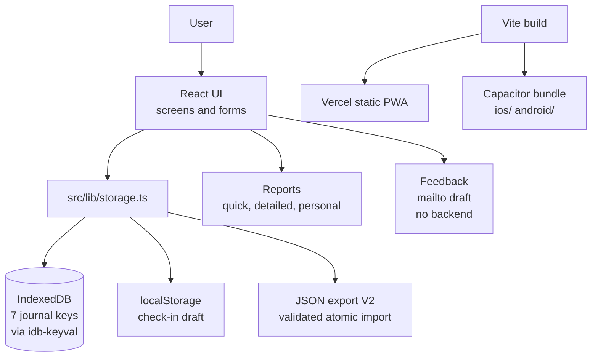

# WakeState

WakeState is a **narcolepsy-first, pattern-tracking app** designed to help people living with narcolepsy (and related sleep-wake conditions) understand and communicate their lived experience more clearly.

> **No backend.** WakeState is a fully local app. The Supabase feedback backend was removed on 2026-10-02; the app makes no network requests of its own and feedback is an email draft. See [docs/ARCHITECTURE.md](docs/ARCHITECTURE.md).

It focuses on **wake-state instability, events, medications, and last night's sleep**: not diagnosis, not treatment, and not wearable-grade sleep scoring. WakeState is built for real humans on low-energy days.

---

## What WakeState Is (and Is Not)

**WakeState is:**

- A self-tracking and pattern-recognition tool
- Designed primarily for people with narcolepsy
- Optimized for clarity, speed, and low cognitive load
- Event-first (naps, cataplexy) rather than score-first
- Local-first and privacy-respecting
- Free, with no accounts and no ads
- Built to support better conversations with clinicians, employers, and support groups

**WakeState is not:**

- A diagnostic tool
- A medical device
- A treatment recommendation engine
- A wearable replacement
- A sleep score app

All insights are framed as **observations**, not conclusions.

---

## Four Tracking Layers

WakeState separates tracking into four distinct layers to avoid signal contamination:

1. **Wake State**: Continuous, quick check-ins focused on narcolepsy-relevant symptoms (e.g. sleep pressure, microsleeps, cognitive fog, effort aversion)
2. **Events**: Discrete occurrences that should never be averaged (e.g. naps, cataplexy)
3. **Medications**: What was taken and when, logged simply, without advice or interpretation
4. **Last Night's Sleep**: A single daily snapshot focused on narcolepsy-relevant sleep features (not a full sleep tracker)

These layers are intentionally kept separate and only combined carefully in reporting.

---

## Key Features

- **Wake State Logging**: 30-second check-ins, narcolepsy symptoms separated from overlapping symptoms, no scoring pressure
- **Event Logging**: one-tap logging for naps and cataplexy; frequency, timing, and clustering analytics that never average events into scores
- **Medication Logging**: first-time setup to define a regimen, one-tap "Taken" logging, structured dose/frequency inputs, manufacturer links for reference only. Supports stimulants, Wakix, oxybates, and emerging orexin therapies. The medication catalog is data, governed separately; see [docs/MEDICATION-CATALOG.md](docs/MEDICATION-CATALOG.md)
- **Last Night's Sleep**: one entry per day (editable); total sleep time, wakeups, hypnagogic/hypnopompic hallucinations, vivid dreams, AHI if known
- **Dashboard**: consumer-grade clarity; event-first; adaptive to what is logged; plain-language insights with explanations
- **Reports & Export**: human-readable reports are primary (quick, detailed, personal); JSON backups carry the full journal; CSVs are reports-only, not a restore format
- **Progressive Web App (PWA)**: installable, works offline, "Add to Home Screen"; no App Store required. Native iOS/Android builds bundle the same web app via Capacitor

---

## Release State

**Last verified: 2026-10-20.** This section is the current-release snapshot; [docs/LAUNCH.md](docs/LAUNCH.md) owns the dated evidence trail (newest entries first).

| Platform | State |
| --- | --- |
| iOS | 1.0.2 (build 3) submitted to App Review on 2026-10-13. [VERIFY: submission outcome not yet recorded in docs/LAUNCH.md] |
| iOS | Undo fix landed in source for 1.0.3 (not in any store build). 1.0.3 (build 4) candidate noted 2026-10-14. [VERIFY: candidate state not yet recorded in docs/LAUNCH.md] |
| Android | Release preparation per [docs/ANDROID-RELEASE.md](docs/ANDROID-RELEASE.md); native build config and backup exclusions verified in source |
| Web (PWA) | Static Vite build on Vercel; origin must stay stable (IndexedDB is per-origin) |

App version in `package.json`: `1.0.3`. The pre-Oct 2 architecture (server feedback, Supabase client) is gone; see docs/ARCHITECTURE.md.

---

## Tech Stack

| Layer | Technology |
| --- | --- |
| Native wrapper | Capacitor 8.5.1 (`@capacitor/cli` 8.4.3; app id `com.wakestate.app`) |
| UI | React 18.3 + TypeScript 5.8 + Tailwind CSS 3.4 + shadcn/ui (Radix primitives) |
| Routing | react-router-dom 7 |
| Charts | recharts 2.15.4 |
| Forms | react-hook-form + zod |
| Build | Vite 7.3 (+ `vite-plugin-pwa`) |
| Storage | IndexedDB via idb-keyval 6.2.2 + localStorage check-in draft; no hosted database |
| Native plugins | `@capacitor/app`, `@capacitor/filesystem`, `@capacitor/share` |
| Tests | vitest 4 (`fake-indexeddb` for storage tests) |
| Backend | None (removed 2026-10-02) |
| Analytics SDKs | None, by design (see [docs/ANALYTICS.md](docs/ANALYTICS.md)) |

**No environment variables are required.** Hosting notes are in [docs/HOSTING.md](docs/HOSTING.md): "No environment variables or backend are required. Tracking is local, and feedback is an email link."

---

## Repo Layout

| Path | Contents |
| --- | --- |
| `src/components/` | Screens (check-in, events, medications, sleep, reports/export, settings) and the medication catalog |
| `src/lib/` | Storage, validation, reports, download, support; tested library code |
| `src/types/` | Shared TypeScript types |
| `ios/`, `android/` | Capacitor native projects (bundle the web assets; not committed binaries) |
| `public/` | PWA icons, `privacy.html`, `robots.txt` |
| `scripts/` | `build-android.sh`, `verify-android-signature.mjs`, `check-platform-independence.sh` |
| `docs/` | Architecture, launch, release, security, privacy and medication references (see index below) |
| `.github/workflows/` | `android-readiness.yml`, `platform-independence.yml` (no backup workflow; backups are user-driven) |

---

## Quick Start

Use Node 22+ and npm (`package-lock.json` is the reproducible dependency source).

```sh
npm ci
npm run dev
npm run validate
npm run native:sync
```

`npm run validate` = typecheck + tests + lint + production web build. `npm run native:sync` builds the native web assets and runs `cap sync` to prepare both native projects.

Capacitor projects in `ios/` and `android/` bundle the app for native testing. Native exports open the system share sheet; the web build keeps browser downloads and PWA support. Signing, store artwork, privacy policy operations, device QA, and store submission are still required. Agent workflow and read order live in [AGENTS.md](AGENTS.md): AGENTS.md, then docs/INDEX.md, then docs/NATIVE-TESTING.md and the newest evidence in docs/LAUNCH.md.

---

## Scripts

| Script | Does |
| --- | --- |
| `dev` | Vite dev server |
| `build` | Production web build (`vite build`) |
| `build:dev` | Development-mode build |
| `build:native` | Native-mode build for Capacitor bundling |
| `native:sync` | `build:native` then `cap sync` (prepares ios/ and android/) |
| `native:ios`, `native:android` | Open the native projects in Xcode / Android Studio |
| `typecheck` | `tsc --noEmit -p tsconfig.app.json` |
| `test` | `vitest run` |
| `lint` | `eslint .` |
| `validate` | typecheck + test + lint + build |
| `preview` | Preview the production build |
| `android:build` | `sh scripts/build-android.sh` |
| `android:verify-signature` | `node scripts/verify-android-signature.mjs` |

---

## Testing and CI

- Regression suite: **49 tests** pass under `npm run validate` (per docs/LAUNCH.md, Oct 13; the pre-Oct history shows the suite doubling from 22)
- CI: `.github/workflows/android-readiness.yml` and `.github/workflows/platform-independence.yml` (the latter runs `scripts/check-platform-independence.sh`, enforcing no hosted app-builder tooling, hosting, icons, env vars, or assets)
- Device and store acceptance discipline: [docs/NATIVE-TESTING.md](docs/NATIVE-TESTING.md); results and launch gates in [docs/LAUNCH.md](docs/LAUNCH.md)

## Documentation Index

| Doc | Covers |
| --- | --- |
| [docs/ARCHITECTURE.md](docs/ARCHITECTURE.md) | Local-first storage deep dive, the no-backend architecture, Capacitor native layer, export/import as data portability |
| [docs/ANALYTICS.md](docs/ANALYTICS.md) | No analytics by design (the documented absence) |
| [docs/BACKUP.md](docs/BACKUP.md) | Backup runbook: JSON export/import V2, coverage, cadence, open items |
| [docs/MEDICATION-CATALOG.md](docs/MEDICATION-CATALOG.md) | The medication data library and its id-lock governance |
| [docs/MEDICATION-REFERENCE.md](docs/MEDICATION-REFERENCE.md) | Refresh rules, agent refresh prompt, review log (full governance) |
| [docs/LAUNCH.md](docs/LAUNCH.md) | Dated launch evidence and release gates (mutable; newest first) |
| [docs/NATIVE-TESTING.md](docs/NATIVE-TESTING.md) | Native/store testing: core smoke, baseline, privacy acceptance |
| [docs/ANDROID-RELEASE.md](docs/ANDROID-RELEASE.md) | Android release preparation |
| [docs/HEALTH-APP-READINESS.md](docs/HEALTH-APP-READINESS.md) | Health and privacy launch review |
| [docs/SECURITY.md](docs/SECURITY.md) | Security and privacy review (source and dependency review) |
| [docs/HOSTING.md](docs/HOSTING.md) | Vercel static PWA hosting; origin-stability warning |
| [docs/INDEX.md](docs/INDEX.md) | Documentation index |
| [AGENTS.md](AGENTS.md) | Agent workflow: read order, release rules, platform independence |

---

## Design Philosophy

WakeState is designed for people who are cognitively fatigued, easily overwhelmed, and tired of explaining themselves.

- **Low friction over completeness**
- **Patterns over precision**
- **Events over averages**
- **Explanation over interpretation**
- **Calm over clinical**

If a feature adds cognitive load without adding clarity, it doesn't belong.

## Privacy Stance

WakeState is a personal journal, not a medical decision tool:

- Local-first: your journal lives on your device (IndexedDB), not on a server
- **No analytics SDK by design** (see docs/ANALYTICS.md); the in-app Settings copy says "No advertising or analytics SDK is included."
- No backend at all since 2026-10-02; the app makes no network requests of its own and the Android manifest has no INTERNET permission
- Feedback opens a draft in your email app; nothing is sent without you sending it
- Android OS backup and device transfer are disabled, so JSON exports are your backup (see docs/BACKUP.md)
- No encryption or app lock: protect the device; the UI communicates these limits

---

## Architecture at a Glance



See docs/ARCHITECTURE.md for the full deep dive with storage, flow, and export/import diagrams.

---

## Related

[SleepConverter](https://github.com/TaylorONeal/SleepConverter) converts SleepON and
Go2Sleep ring exports into a CSV that SleepHQ accepts, offline and in one click.

## More from me

I'm Taylor O'Neal. I work in product and analytics, teach at Miami University, and put the
tools I actually use into the open.

- [tayloroneal.com](https://www.tayloroneal.com) for what I'm working on and how to reach me
- [@businesstaylor](https://x.com/businesstaylor) on X, where I post build notes
- [@grizzpm](https://www.youtube.com/@grizzpm) on YouTube

If this saved you time, a star helps other people find it. Issues and PRs are welcome.
