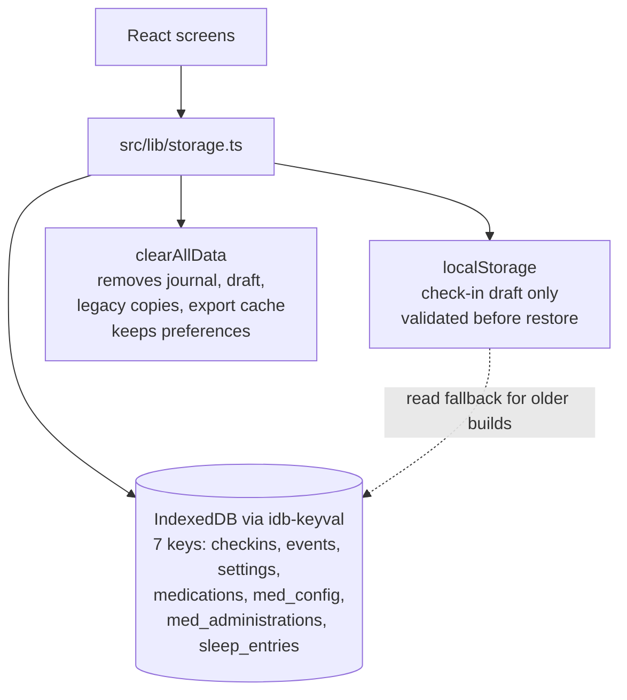
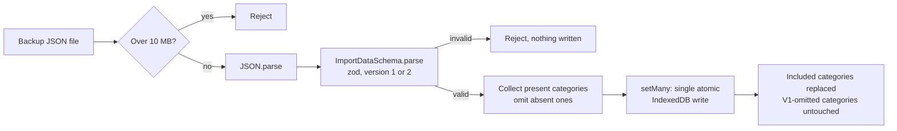
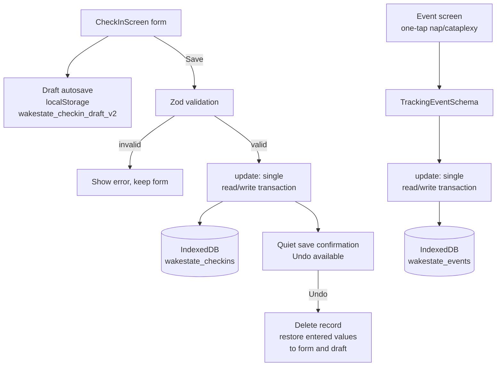

# WakeState Architecture

**What this is:** the technical architecture of WakeState, a narcolepsy-first pattern-tracking app that is fully local: no hosted database, no backend server, no analytics SDK. This doc is the engineering counterpart to the product overview in `README.md`.

**Last verified: 2026-10-20** (repo HEAD `4fc7504`).

---

## 1. Local-First Storage

All journal data lives on the device. `src/lib/storage.ts` wraps IndexedDB through the `idb-keyval` library (v6.2.2), with `localStorage` kept as a read fallback for records saved by older builds. Writes go to IndexedDB only; `localStorage` is never written except for the check-in draft.

### Storage keys

| IndexedDB key | Holds | Read/write API |
| --- | --- | --- |
| `wakestate_checkins` | Wake-state check-ins (`CheckIn[]`) | `getCheckIns`, `saveCheckIn`, `updateCheckIn`, `deleteCheckIn` |
| `wakestate_events` | Discrete events, e.g. naps and cataplexy (`TrackingEvent[]`) | `getEvents`, `saveEvent`, `deleteEvent` |
| `wakestate_settings` | App preferences (`AppSettings`: theme, context display) | `getSettings`, `saveSettings` |
| `wakestate_medications` | User's saved medication entries (`UserMedications`, keyed by medication id) | `getUserMedications`, `saveMedicationEntry`, `removeMedicationEntry` |
| `wakestate_med_config` | Medication regimen (`UserMedicationConfig`) | `getMedicationConfig`, `saveMedicationConfig` |
| `wakestate_med_administrations` | Doses taken (`MedicationAdministration[]`) | `getMedicationAdministrations`, `saveMedicationAdministration`, `removeMedicationAdministration` |
| `wakestate_sleep_entries` | Last night's sleep entries (`SleepEntry[]`, one per date) | `getSleepEntries`, `getSleepEntryForDate`, `saveSleepEntry`, `deleteSleepEntry` |

Types live in `src/types/`; zod schemas for every category live in `src/lib/validation.ts`.

### Write semantics

- Concurrent inserts (check-ins, events, administrations) use a single IndexedDB read/write transaction via `idb-keyval`'s `update()`, so concurrent saves cannot overwrite each other. A ten-way concurrent check-in test covers this.
- Sleep saves upsert by date (one entry per day, editable); edits and deletes are atomic against concurrent inserts.
- `clearAllData()` removes all six journal keys from IndexedDB **and** their legacy `localStorage` copies plus the check-in draft and the native export cache, so fallback reads cannot resurrect deleted records. Settings (preferences) are deliberately kept.

### Check-in draft

`src/components/CheckInScreen.tsx` stores an in-progress draft in `localStorage` under `wakestate_checkin_draft_v2` so an interrupted check-in can be restored. Drafts are validated with `CheckInDraftSchema` (`src/lib/validation.ts`) before restoration; corrupt drafts are discarded without crashing the form.

---

## 2. Validation and the V2 Backup Schema

`src/lib/validation.ts` defines the zod schemas that guard every write path that crosses a trust boundary:

| Schema | Guards |
| --- | --- |
| `CheckInSchema`, `TrackingEventSchema`, `SleepEntrySchema` | Journal records (domains are 1-5 scales; dates must match `YYYY-MM-DD`) |
| `MedicationEntrySchema`, `MedicationConfigSchema`, `MedicationAdministrationSchema` | Medication categories (frequencies and timings are enums) |
| `AppSettingsSchema` | Preferences |
| `CheckInDraftSchema` | The `localStorage` check-in draft before restoration |
| `ImportDataSchema` | Backup imports: `version` must be `1` or `2` (optional); each category array is capped at 50,000 records |

Import (`importData` in `src/lib/storage.ts`) follows this sequence: reject files over 10 MB; `JSON.parse`; `ImportDataSchema.parse` (full validation first); collect the present categories; write them all with a single `setMany` atomic IndexedDB write. Import **replaces** the included categories; it does not merge. V1 backups remain supported: categories omitted from the import are left untouched, and unsupported versions or empty backups are rejected. The import UI copy says replacement explicitly, not merge.

CSV export (`exportToCSV`, same file) covers check-ins only and is **reports-only**: CSVs cannot be re-imported as backups. Spreadsheet formula prefixes are neutralized (`escapeCSVCell`) so a note starting with `=` cannot become an active formula.

---

## 3. The No-Backend Architecture

### What was removed (2026-10-02)

The repo previously ran a Supabase feedback backend: the Supabase client, the edge functions under `supabase/functions/` (`submit-feedback`, `get-challenge`, `_shared/request-body`), and the in-app feedback submission flow. On 2026-10-02 all of this was removed (`docs/SECURITY.md` header note: "The app has no backend"; SEC-01 closed by removal).

### What replaced it

Feedback now opens a **draft in the user's email app** via `mailto:` (`src/lib/support.ts`, `SUPPORT_EMAIL` / `FEEDBACK_MAILTO`). Nothing is sent automatically, and the draft contains no journal records. The native acceptance case states this explicitly: "A support email draft is not a send and must not include journal records automatically" (`docs/NATIVE-TESTING.md`).

### The resulting network posture

- The Android manifest has **no INTERNET permission** (removed in PR #10; verified in `docs/HEALTH-APP-READINESS.md`).
- `docs/SECURITY.md` states the app has "no network requests of its own".
- `package.json` contains no analytics, telemetry, crash-reporting, or push SDKs (see `docs/ANALYTICS.md`).
- User-initiated sharing (export file to a chosen destination, email draft) is distinct from app telemetry (`docs/NATIVE-TESTING.md`).

Agent rule (`AGENTS.md`): "The app currently has no backend." Any new backend must be separately reviewable and never claimed as verified from source edits alone.

---

## 4. Capacitor Native Layer

`ios/` and `android/` are the Capacitor 8.5.1 native projects. The web app (`npm run build:native`, Vite native mode) is bundled into both; `npm run native:sync` builds then runs `cap sync`. App id: `com.wakestate.app` (minSdk 24, targetSdk 36 per the source manifest evidence in `docs/HEALTH-APP-READINESS.md`).

- **Exports on native** open the system share sheet (`@capacitor/share`, `@capacitor/filesystem` with an export cache; `clearExportCache` in `src/lib/download.ts`); **on web** they are browser downloads. PWA support stays in the web build.
- The app reads its installed binary version/build via `@capacitor/app` (`src/lib/appVersion.ts`) and shows it in Settings so a user or reviewer can identify the exact build.
- Android OS backup and device transfer are disabled (`android:allowBackup="false"` in the merged manifest), so on-device data has no OS-level safety net; see `docs/BACKUP.md`. iOS backup behavior is a separately listed verification (`docs/NATIVE-TESTING.md`).

## 5. Check-In and Event Flow

Key design points:

- Check-ins are continuous, low-friction symptom snapshots; events are discrete occurrences that analytics must never average (frequency, timing, clustering only).
- Save failures preserve form contents and offer a retry; a successful save is never claimed before the write completes.
- Undo restores the entered values (in source for 1.0.3; see `docs/LAUNCH.md` Oct 13 entry).

## 6. Export and Import as the Data Portability Story

There is no account, no cloud sync, and no scheduled backup process. **User-driven JSON export/import is the data portability story** (`src/components/ExportScreen.tsx` calling `exportAllData`/`importData` in `src/lib/storage.ts`):

| Path | Format | Restore? |
| --- | --- | --- |
| Full JSON backup (`exportAllData`) | Version 2 JSON, `version: 2`, `exportedAt`, all seven keys | Yes, via validated atomic import |
| Human-readable reports (`src/lib/reports.ts`) | Quick / detailed / personal text reports, 7/30/90-day ranges | No, narrative only |
| CSV export (`exportToCSV`) | Check-ins only | No, reports-only |

Full runbook: `docs/BACKUP.md`.

## 7. Hosting

The PWA is a static Vite build on Vercel (`docs/HOSTING.md`): Vercel runs `npm ci` and `npm run build`, serves `dist/`, and `vercel.json` handles the SPA rewrite, security headers, and service-worker caching. The native builds do not depend on this host.

**Origin-stability warning** (verbatim from `docs/HOSTING.md`): "Keep the web origin stable: browser storage (IndexedDB) is per origin, so changing the domain strands existing web users' records until they export and import."

---

## Read Order for Agents

Per `AGENTS.md`: AGENTS.md, then `docs/INDEX.md`, then `docs/NATIVE-TESTING.md` and the newest evidence in `docs/LAUNCH.md`. Release acceptance, secrets, and authorization boundaries follow the shared `NATIVE-RELEASE-POLICY.md` in `app-launch-playbook` (not restated here). Platform independence is CI-enforced by `scripts/check-platform-independence.sh`.
