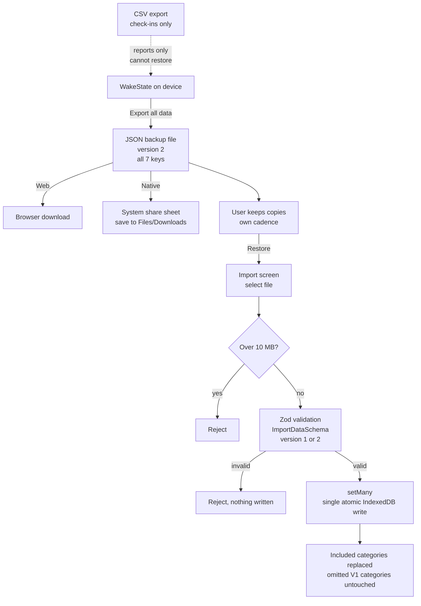

# Backup Runbook

**What this is:** the WakeState backup story. Because the app is fully local (no backend, no cloud sync, Android OS backup disabled), **user-driven JSON export/import is the only backup mechanism**. This runbook covers the procedure, what is covered, user cadence, and the known open items.

**Last verified: 2026-10-20** (repo HEAD `4fc7504`).

## Mechanism at a Glance

There is **no scheduled or automated backup process**. `.github/workflows/` contains only `android-readiness.yml` and `platform-independence.yml`; no workflow backs up user data. Backup and restore happen entirely through the Export screen (`src/components/ExportScreen.tsx`) using `exportAllData` / `importData` in `src/lib/storage.ts`.

## What Is Covered

A V2 JSON backup includes all seven IndexedDB keys:

| Key | Data |
| --- | --- |
| `wakestate_checkins` | Wake-state check-ins |
| `wakestate_events` | Events (naps, cataplexy, ...) |
| `wakestate_settings` | Preferences |
| `wakestate_medications` | Saved medication entries |
| `wakestate_med_config` | Medication regimen |
| `wakestate_med_administrations` | Doses taken |
| `wakestate_sleep_entries` | Last night's sleep entries |

The export payload is tagged `version: 2` with an `exportedAt` timestamp. V1 backups remain importable: categories omitted from a V1 file are left untouched.

Not covered by JSON export: the in-progress check-in draft (transient), legacy `localStorage` copies (removed on Clear Data), and the native export cache (cleared on Clear Data). Preferences survive Clear Data (settings are kept by design).

## Export Procedure (User-Facing)

1. Open the **Export / Reports** screen.
2. Choose **Export all data** (JSON backup). This is the backup; the report and CSV options are narratives and reports-only.
3. **Web:** the browser downloads the JSON file; save it somewhere safe (cloud drive, computer). **Native:** the system share sheet opens; save to Files/Downloads or another destination you control.
4. Keep dated copies. The store copy warns **"Keep regular backups"** precisely because the data lives on-device and there is no other safety net.

## Import Procedure (User-Facing)

1. Open the **Import** section of the Export screen and select a backup JSON file.
2. The app validates before touching any data: files over 10 MB are rejected; the JSON must parse; `ImportDataSchema` (zod, `src/lib/validation.ts`) must accept it with `version` 1 or 2.
3. On success, all validated categories are written with a single atomic `setMany` IndexedDB write. **Import replaces the included categories; it does not merge.** The import UI copy says replacement explicitly.
4. The screen reports counts of check-ins and events restored.

## Cadence Guidance

Export a JSON backup regularly: after any period of journaling you would not want to redo, and **before** reinstalling the app, switching devices, or changing anything about the installation. There is no automatic reminder in the app today, so the cadence is on the user. The store listing carries the "Keep regular backups" warning for this reason.

## Explicit Platform Limits

- **Android: OS backup and device transfer are DISABLED** (`android:allowBackup="false"`; `docs/HEALTH-APP-READINESS.md`: "disables Android backup and device transfer"). A device reset or reinstall without a JSON backup loses the journal. State this to users; do not imply the OS has a copy.
- **iOS: restore is UNVERIFIED on device.** This is an explicit open item. Suggested test (`docs/NATIVE-TESTING.md`): on a signed release build, back up the device (or use device transfer), restore onto a clean device, and confirm the journal, settings, and export behavior survive; record the result in `docs/LAUNCH.md`.

## Cross-Device Restore: Planned, Not Yet Built

`docs/LAUNCH.md` records: "Future requirement: restore backups when switching devices or platforms." Taylor's 2026-10-06 instruction on it: "**for future work, with no testing now**. Keep this improvement outside the current launch-fix batch."

Recorded state: the requirement is acknowledged and parked. It has **no owner, no plan, and no testing** as of 2026-10-20. Next step is an owner decision: either plan it (define the cross-device import UX and verify the V2 schema round-trips across platforms) or explicitly defer it again with a recorded reason. Do not claim it works until a restore is tested on real devices.
