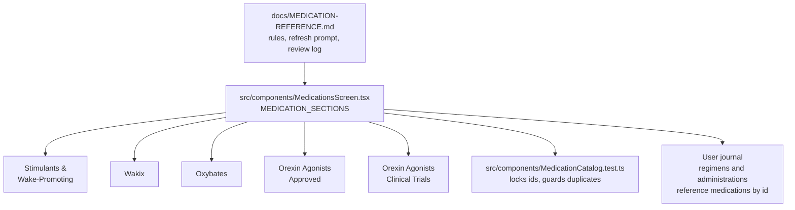

# Medication Catalog

**What this is:** a portfolio-standard summary of WakeState's medication data library: the catalog of narcolepsy medications the app presents in the Medications screen. It is a **data library**, not user data: it ships in the app bundle, and users' saved regimens reference it by stable id.

**Last verified: 2026-10-20** (repo HEAD `4fc7504`). The full governance lives in `docs/MEDICATION-REFERENCE.md` (rules, agent refresh prompt, review log); this doc summarizes it.

## Structure

The catalog is `MEDICATION_SECTIONS` in `src/components/MedicationsScreen.tsx`, a typed array of sections:

```ts
interface MedicationSection {
  title: string;
  icon: React.ReactNode;
  description?: string;
  medications: MedicationInfo[];
}

interface MedicationInfo {
  id: string;               // stable, never changed or deleted
  brandName: string;
  genericName: string;
  mechanism?: string;
  description: string;
  manufacturerUrl: string;  // reference only
  doseOptions?: string[];   // every labeled strength; no dosing advice
  trialTracking?: boolean;  // trial/open-label switch
}
```

At HEAD the catalog holds **5 sections, 15 entries**:

| Section | Class |
| --- | --- |
| Stimulants & Wake-Promoting Medications | Approved |
| Wakix (Histamine-Based Wake Regulation) | Approved |
| Nighttime / Deep Sleep Medications (Oxybates) | Approved |
| Orexin Receptor Agonists (Approved) | Approved |
| Orexin Receptor Agonists (Clinical Trials) | Investigational (`trialTracking: true`) |

Approved drugs go in Approved sections; investigational drugs go in Clinical Trials sections with the trial/open-label switch. Discontinued programs are marked in the description, never deleted, so past trial participants keep their records. Descriptions carry no dosing advice, no efficacy comparisons, and keep the non-diagnostic framing; section descriptions are date-stamped ("Reference as of October 2026").



## The ID-Lock Rule

**Never change or delete an existing medication id.** Saved regimens (`wakestate_med_config`) and administrations (`wakestate_med_administrations`) reference medications by id; renaming or deleting an id would orphan a user's health records.

This is enforced in code by `src/components/MedicationCatalog.test.ts`, which locks the 14 legacy ids:

`adderall, ritalin, dexedrine, vyvanse, sunosi, provigil, nuvigil, wakix, xyrem, xywav, lumryz, tak-861, danavorexton, alks-2680`

The test also asserts there are no duplicate ids and that every entry in the Orexin sections offers the trial switch. When a trial code becomes a generic or brand name, the old id is kept and only `brandName`/`genericName` change (example: `tak-861` is now Orzeyful).

## Refresh Process

`docs/MEDICATION-REFERENCE.md` owns the refresh discipline:

- **Rules:** primary sources only (FDA, manufacturer, ClinicalTrials.gov, company investor releases or SEC filings); aggregators are leads, not evidence. Vaguer wording ("in clinical trials") when status cannot be confirmed.
- **Agent refresh prompt:** a paste-ready prompt that re-verifies every entry against primary sources as of today, runs `npm run validate`, and opens a draft PR with a before/after table linking every source.
- **Review log:** 2026-10-08 (#28, TAK-861 became Orzeyful, ALKS-2680 became alixorexton, cleminorexton added, danavorexton marked discontinued for narcolepsy); 2026-10-13 (iOS 1.0.2 prep open item: orzeyful.com still shows coming soon pending DEA scheduling, expected by November 2026; full list not re-verified).
- **Per `AGENTS.md`:** run the refresh before every store release; medication names and approval status always go through `docs/MEDICATION-REFERENCE.md`.

## Relationship to User Data

The catalog is reference text; the user's data is theirs: `wakestate_medications` (their entries), `wakestate_med_config` (their regimen), and `wakestate_med_administrations` (their doses taken), all covered by the JSON backup in `docs/BACKUP.md`. Deleting a medication from the catalog would not delete user records, which is exactly why ids are frozen: records must keep pointing at something meaningful.
